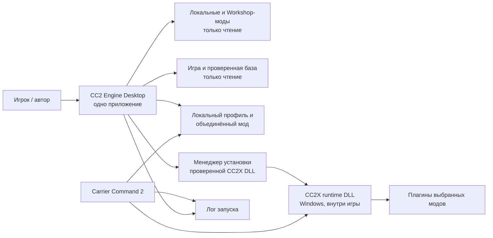
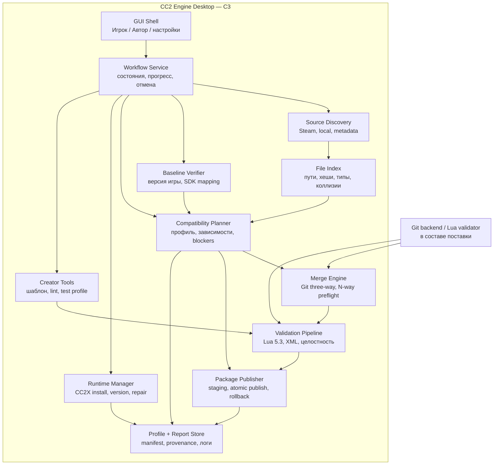
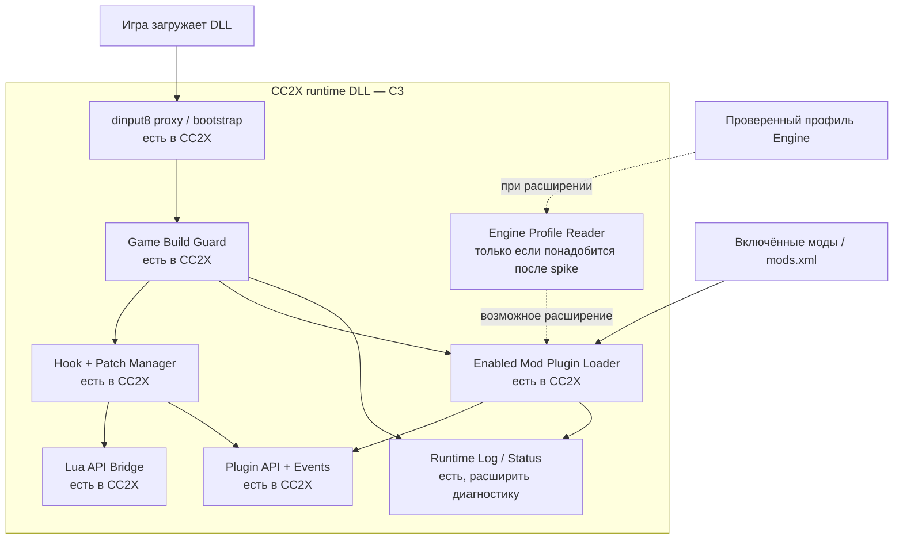

# 14. CC2 Engine: единая экосистема модов — план и C3

**Дата:** 2026-10-28. **Статус:** проект архитектуры для обсуждения; описание цели и этапов, не заявление о готовой реализации.

## 1. Решение по продукту

CC2 Engine — **одно настольное приложение** для игроков и авторов модов, с общими профилями, проверками и отчётами. Для модов, которым нужен код внутри игры, приложение управляет **одним встроенным runtime-компонентом**. На Windows его основой предлагается существующий CC2X (`dinput8.dll`), который загружается самой игрой. Отдельный пользовательский инъектор, фоновый демон и вторая программа не нужны.

Практически это два процесса и два уровня ответственности, но один пользовательский продукт:

1. **Desktop:** ищет моды, проверяет совместимость, собирает объединённый локальный мод при необходимости, управляет профилями и установленным runtime.
2. **Runtime DLL:** предоставляет Lua API и загружает нативные плагины в поддерживаемой Windows-версии игры. Она не выполняет текстовое слияние в игровом процессе.

Для автора в том же приложении есть режим разработки: создание структуры мода, проверка пакета и требований к runtime, локальный тестовый профиль и диагностический отчёт. Исходники автор пишет в своей среде; Engine не пытается заменить редактор кода и компилятор. Моды остаются совместимы со штатным Workshop/меню игры там, где не требуют дополнительных функций.

**Почему CC2X как основа:** уже реализованы `dinput8` proxy, guard игровой сборки, Lua API, загрузчик 32-битных DLL и проверка пересекающихся патчей. Второй собственный инъектор повторил бы эту работу и создал бы конкуренцию за `dinput8.dll`. Для первой интеграции достаточно закреплённой проверенной сборки CC2X и менеджера её установки. Форк/изменение CC2X нужен только после доказанной потребности: например, если перенос DLL в объединённый мод не сохраняет `plugin_dir`/assets и требуется читать профиль Engine. Условия GPL-3.0-or-later и поставки исходников проверяются до распространения.

**Ограничение платформ:** Desktop по принятому [ADR-0005](adr/0005-windows-macos-support.md) должен работать на Windows и macOS. Доступный CC2X runtime поддерживает только Windows и одну указанную им игровую сборку. На Mac нельзя обещать загрузку Windows DLL. Узкий Mac spike зарегистрировал минимальный `cc2x` API на двух обнаруженных Mac-бинарниках (`1.5.17` в наружном app bundle и `1.5.18` во вложенном), но пользовательского bridge, полноценного game smoke и plugin host ещё нет; подробные доказательства, C3 и план проверки — в [исследовании Mac runtime](15-MAC-RUNTIME-FEASIBILITY.md).

## 2. Что есть сейчас и что меняется

Сейчас `cc2_mce/` — read-only технический срез 0.1.0.dev1: discovery, baseline manifest, Git three-way merge, валидация и JSON-отчёт. `build` без `--dry-run` запрещён; GUI, package builder, управление runtime, профили, авторский режим и игровой acceptance отсутствуют. 84 синтетических теста проходят локально на macOS, но не доказывают работающий мод в игре. [Журнал M0](12-M0-VALIDATION.md) остаётся открытым.

Принятые [ADR-0001](adr/0001-offline-packager-first.md) и [roadmap](07-ROADMAP.md) описывают офлайн-упаковку как первую поставку, а CC2X bridge относят к позднему этапу. Новая продуктовая цель переносит **управление CC2X runtime** в обязательный пользовательский поток. Не следует смешивать это с неподтверждённой идеей динамического перехвата игровых ресурсов: офлайн-слияние файлов остаётся основным способом устранить совпадение путей.

Перед реализацией надо обновить PRD, ADR и roadmap одним согласованным решением: «один Hub + включённый runtime», перечень Windows/macOS возможностей, правила установки `dinput8.dll`, обращение с native DLL и критерии релиза. Этот документ — основа такого изменения.

## 3. Контейнеры системы (C2, для границ C3)

`Desktop` и `runtime DLL` — два контейнера одного продукта. Игра/Steam/Workshop — внешние системы. GUI не обязан оставаться открытым во время игры; на диске остаются только проверенная DLL, профиль/пакет и диагностические файлы. Собственный сетевой сервис или аккаунт на первом релизе не нужен.

## 4. C3 — компоненты Desktop

| Компонент | Вход → выход | Главный инвариант |
|---|---|---|
| `Source Discovery` | папки Steam/local → `ModRef` | только чтение, проверка metadata и ссылок |
| `File Index` | ресурсы модов → `logical_path → variants` | один нормализованный игровой путь, отказ на case/Unicode/path collision |
| `Baseline Verifier` | игра + оригиналы → проверенная база | неизвестная/неподходящая база не разрешает 3-way merge |
| `Compatibility Planner` | выбранные моды + база + runtime capabilities → неизменяемый `BuildPlan` | все blockers видны до создания; изменение входа аннулирует план |
| `Merge Engine` | base + N вариантов → bytes/status/provenance | никаких `last mod wins` и тихой потери варианта |
| `Validation Pipeline` | bytes + тип → результат проверки | syntax/format не подменяет игровой тест |
| `Package Publisher` | актуальный план → отдельный локальный мод | исходники не меняются; при сбое прежний output остаётся |
| `Runtime Manager` | проверенная сборка CC2X + игра → installed/blocked/repairable | не перезаписывает чужой `dinput8.dll`, не ставит runtime на неизвестную сборку |
| `Creator Tools` | проект автора → шаблон, lint, тестовый профиль | не исполняет мод в процессе Desktop |
| `Profile + Report Store` | входные/выходные хеши, решения, диагностика → воспроизводимое состояние | отчёт отделён от игрового `content/`, личные пути редактируются при экспорте |

`Workflow Service` — прикладной API для GUI и внутреннего CLI. Правила совместимости живут в core, а не в кнопках и не в парсинге stdout. Для GUI-кандидата разумен PySide6, поскольку ядро уже на Python, но выбор закрепляется только после Windows/macOS spike по упаковке, доступности и лицензии.

## 5. C3 — компоненты Windows runtime

Технически текущий CC2X — proxy DLL, которую игра загружает сама, а не внешний процесс, внедряющий DLL в работающую игру. Он читает `mods.xml` и загружает `content/cc2x/*.dll` **только из включённых модов**. Поэтому при объединении двух конфликтующих модов нельзя просто выключить оригиналы и забыть про их плагины. Базовый путь: включить один сгенерированный мод с проверенно перенесёнными плагинами и их assets. Если конкретные плагины так не работают, исследовать `Engine Profile Reader`, который загружает их из исходных каталогов, сохраняя `plugin_dir`; до доказанного game smoke такую пару блокировать.

Новый reader и тяжёлую проверку файлов нельзя просто добавить в текущий `DllMain`: `startup()` и загрузка плагинов уже выполняются в loader lock. Перед расширением нужен отдельный runtime spike и, вероятно, перенос существенной инициализации в безопасную точку. Перехват чтения игровых ресурсов/виртуальная ФС **не входит** в базовую схему: соответствующего готового hook в CC2X нет.

## 6. Контракты и три сценария исполнения

**`ModDescriptor` (версия схемы):** ID/источник/хеш, игровые пути, автор и версия, требования к игре и CC2X API, плагины и их companion assets, заявленные зависимости/несовместимости. Для старых модов без descriptor значения `unknown`, а не «зависимостей нет». Место descriptor внутри Workshop-мода нужно проверить: Workshop и игра должны сохранять/игнорировать файл корректно. До проверки приложение хранит локальные сведения отдельно и распознаёт DLL по факту наличия.

**`Profile`:** список выбранных модов и порядок, хеши всех входов/базы, версия engine/CC2X, требуемый режим, ID выходного мода, решения пользователя. Профиль не означает, что игра уже активировала мод.

**`BuildPlan`:** результат анализа с явными `copy`, `deduplicate`, `clean`, `conflict`, `no_base`, `native_plugin_review_required`, `unsupported_binary`, `tool_error`; плюс `game_ready` и `runtime_ready` как отдельные состояния. План связан с хешами и инвалидируется после обновления игры/Workshop, изменения выбора, порядка или версии инструментов.

**Путь A — исходные моды совместимы:** одинаковых игровых путей нет. Engine не делает лишнюю копию; игрок включает исходные моды штатно. Если им нужен CC2X, Engine проверяет и устанавливает один runtime. Это сохраняет обновление Workshop и исходные plugin paths.

**Путь B — пересечение можно слить:** Engine создаёт один локальный мод, содержащий уникальные ресурсы и проверенные результаты merge. Исходные конфликтующие моды отключаются; объединённый включается в игре. Если есть DLL, каждая должна попасть в выходной мод вместе с нужными файлами **только после проверки** имён, архитектуры, `plugin_dir`, ресурсов, версии API, лицензий и игрового запуска. В противном случае путь C.

**Путь C — безопасного решения нет:** пересекающиеся бинарники, две разные DLL с одним именем, неопределённая база, несовместимый runtime/build, ошибки формата или изменения во время проверки → понятный blocker. Не выдавать частичную сборку за рабочую. Для несовместимых Lua/DLL возможна ручная адаптация автором, но не автоматическое «объединение» бинарного кода.

Полная автоматическая активация профиля через запись `mods.xml` — отдельный gate: только при закрытой игре, доказанной схеме, backup и проверенном rollback. До этого Engine показывает точные действия в игровом меню. Это оставляет один центр управления, не ломая системный механизм игры предположением о формате.

### Путь игрока

1. Установить и открыть один CC2 Engine; выбрать найденную игру или указать каталог через окно.
2. Отметить моды. Engine показывает, какие требуют runtime, где файлы пересекаются и какой результат реально доступен.
3. Нажать «Проверить»: получить актуальный план с причинами блокировки, если они есть. При отсутствии пересечений остаются оригинальные Workshop-моды; при безопасно сливаемых пересечениях создаётся отдельный локальный мод.
4. На Windows нажать «Подготовить игру»: Engine сверяет сборку игры и устанавливает свою закреплённую DLL, только если она нужна и место свободно/принадлежит Engine. На Mac недоступная runtime-функция обозначена прямо.
5. Включить указанные моды в штатном меню игры и перезапустить её. Когда формат `mods.xml` будет доказан и rollback проверен, это сможет стать действием «Активировать профиль» в Engine.
6. После запуска Engine показывает по `cc2x.log`, загрузились ли необходимые плагины. При сбое пользователь может вернуться к прежней сборке/профилю через тот же GUI.

### Путь автора

1. В режиме «Для авторов» создать структуру мода или импортировать существующую папку. Указать целевую сборку игры и требуемый CC2X API.
2. Править Lua/XML/C в привычном редакторе; Engine проверяет layout, пути, кодировки, Lua 5.3/XML, список DLL и зависимости, не выполняя код внутри Desktop.
3. Создать тестовый профиль с собственным модом и разрешёнными тестовыми модами. Engine показывает файловые коллизии и runtime-требования до игрового запуска.
4. Получить папку формата, принятого игрой/Workshop, и диагностический отчёт. Размещение машиночитаемого descriptor внутри Workshop-пакета включается только после теста сохранения и чтения такого файла.

## 7. План работ и критерии выхода

| Этап | Конкретная работа | Готово, когда |
|---|---|---|
| **E0. Подтверждение реальности** | Windows game build/fingerprint; исходный SDK той же сборки; реальный `mod.xml`; 2 пересекающихся Lua-мода; CC2X-мод с DLL; поведение `plugin_dir` и companion assets; конкурирующий `dinput8.dll`; Mac runtime/layout отдельно | воспроизводимая матрица и короткий game proof: оба эффекта A+B работают в единственном merged mod, DLL видна в логе; неподтверждённые пути явно перечислены |
| **E1. Контракты** | Обновить PRD/ADR/roadmap, версии схем `ModDescriptor/Profile/BuildPlan`, capability matrix и статусы GUI; определить лицензию Desktop/CC2X fork/bundle | одно непротиворечивое ТЗ; не смешаны host support и game runtime support |
| **E2. Ядро и пакет** | Завершить baseline resolver; N-way/report edge cases; validator Lua 5.3; `mod.xml`; staging/atomic publish/rollback; snapshot/TOCTOU защита | synthetic goldens и реальные разрешённые fixtures проходят; исходники неизменны, сбой не портит прошлую сборку |
| **E3. Один GUI** | Player и Creator в одном окне; onboarding, моды, профили, анализ, blockers, прогресс/отмена, отчёт, настройки; встроенные Git/Lua/runtime | полный сценарий без терминала на чистых Windows/macOS; кнопка создания зависит от engine gates |
| **E4. Runtime в поставке** | Закрепить проверенную CC2X сборку; manager install/repair/remove, ownership hash, конфликт `dinput8`, unknown build; читать `cc2x.log`; проверить no-DLL и Lua-only CC2X моды | одна установка Engine готовит Windows runtime без ручного копирования DLL; игра без Engine GUI запускается; восстановление прежнего состояния проверено |
| **E5. Native-моды при merge** | Прототип переноса DLL+assets в merged mod; диагностика имён, API, patch overlap; game smoke; при неудаче отдельный spike профильного загрузчика CC2X с переносом работы из loader lock | хотя бы две разрешённые к тесту комбинации проходят игру; неподдерживаемые плагины строго блокируются |
| **E6. Авторский путь** | Шаблон мода, manifest/requirements, lint путей и пакета, проверка `cc2x` API, тестовый профиль, отчёт и Workshop-ready folder | автор создаёт и проверяет мод через Engine; пользователь Engine видит реальные требования этого мода |
| **E7. Релиз** | Windows/macOS CI и clean-machine GUI; отдельный Windows game smoke; accessibility; SBOM/notices; восстановление; инструкции игроку и автору | один пользовательский продукт с честной матрицей функций и доказанными сценариями, без внешней ручной установки инструментов |

E0 — блокирующий эксперимент для обещаний runtime и installable output. E2–E4 можно разрабатывать параллельно на синтетических данных, но нельзя закрывать релиз без E0. E5 не означает поддержку любой произвольной DLL. Этап с виртуальной ФС / перехватом ресурсов — отдельный R&D после E7, только если офлайн-пакетирование и профильный загрузчик не решают конкретный кейс.

### Первый исполнимый backlog

| № | Задача | Зависит от | Наблюдаемый результат |
|---|---|---|---|
| 1 | Зафиксировать Windows game build, CC2X build и право на 2 тестовых мода | — | таблица SHA-256 и версий без чужих assets в репозитории |
| 2 | Проверить один минимальный локальный `mod.xml` и его видимость в игре | 1 | известный рабочий шаблон output |
| 3 | Подтвердить SDK → `content/` mapping для двух совпадающих Lua-путей | 1 | проверенная база для настоящего 3-way merge |
| 4 | Прогнать текущий CLI на этих файлах без публикации | 3 | отчёт clean/conflict и точные хеши |
| 5 | Вручную собрать пробный combined mod без DLL и проверить обе функции | 2–4 | game proof офлайн-слияния |
| 6 | Повторить с CC2X plugin: DLL, `plugin_dir`, companion assets, лог | 5 | решение copy-through либо profile reader |
| 7 | Зафиксировать новую продуктовую ADR и контракты профиля/дескриптора | 1–6 | непротиворечивое ТЗ для кода и UI |
| 8 | Выделить Application Service из текущего CLI и сделать GUI/toolchain spike | 7 | runnable окно Windows/macOS с результатом без stdout-парсинга |
| 9 | Реализовать Package Publisher с rollback и повторной проверкой входов | 2–5, 7 | локальный пакет без риска для источников |
| 10 | Реализовать Runtime Manager с ownership/backup/repair | 6–7 | установка/удаление одной управляемой DLL без порчи чужой |
| 11 | Подключить профили, player и creator workflows к одному GUI | 8–10 | полный сценарий и понятные blockers |
| 12 | Пройти clean-machine, CI, game smoke и лицензии | 9–11 | релизные доказательства, а не только синтетические тесты |

## 8. Угловые случаи и действия

| Случай | Действие Engine |
|---|---|
| Игра обновилась; CC2X знает только старую сборку | запретить статус `runtime_ready`; не устанавливать/не активировать новую DLL как рабочую; показать обновление совместимости |
| Уже есть чужой `dinput8.dll` | не перезаписывать и не строить неиспытанную chainload-цепочку; предложить диагностировать и оставить текущую игру нетронутой |
| Workshop обновил мод между анализом и сборкой/запуском | повторить хеши, аннулировать план; прошлую рабочую сборку сохранить, но пометить устаревшей |
| Оба мода имеют `cc2x_foo.dll` | блокировать: текущий CC2X загружает только первую DLL с таким именем |
| Плагины перечислены в неопределённом порядке или их больше 64 | не полагаться на порядок `FindFirstFileW`; проверить/исправить лимит и детерминизм загрузки до поддержки крупных профилей |
| Путь мода с кириллицей/символами вне текущей ANSI code page | проверить `plugin_dir` и логи; при потере символов исправить API на UTF-8/UTF-16 либо блокировать такой runtime-путь |
| DLL из одного мода требует файлы рядом с собой или использует `plugin_dir` | перенос только вместе с проверенными assets и после игрового теста; иначе профильный загрузчик или blocker |
| CC2X отклонил пересекающиеся патчи | статус runtime failure с логом и именами плагинов; успешный текстовый merge не меняет этот вывод |
| Разные исполняемые файлы совпали по PE timestamp/size | Desktop проверяет полный SHA-256; runtime guard и сигнатуры патчей отдельно проверяются до загрузки плагинов |
| Lua синтаксически валиден, механики конфликтуют | отчёт `file clean / gameplay unverified`; ручной smoke на репрезентативной паре обязателен для заявленной совместимости |
| Игра запущена во время установки/удаления DLL или модов | операция откладывается до закрытия игры; никаких горячих замен файлов |
| GUI закрыт, игра стартует из Steam | DLL и профиль доступны без фонового сервиса; runtime сам проверяет поддерживаемый build |
| Mac-пользователь выбрал мод с Windows DLL | показать невозможность запуска native plugin на Mac; офлайн-анализ не выдавать за runtime support |
| Несколько Steam libraries, Unicode/case collisions, symlink/junction | поиск всех библиотек и явный выбор; неоднозначные/выходящие за root пути блокируются |
| Автор хочет опубликовать merged чужие ресурсы | локальная сборка и публичная публикация разделены; Engine не публикует чужой объединённый пакет без проверки прав |

## 9. Самое узкое следующее действие

Сделать E0 на **Windows**: взять реальную игру поддерживаемой сборки и два разрешённых мода, один из которых использует CC2X plugin; вручную собрать минимальный объединённый мод с корректным `mod.xml`, проверить загрузку обеих функций и `cc2x.log`. Одновременно зафиксировать хеши игры, SDK и входов. Если перенос DLL ломает `plugin_dir`, решение о профильном загрузчике принимается по этому доказательству, а не из предположения. После E0 обновить ADR и разложить E1–E7 на задачи реализации.
