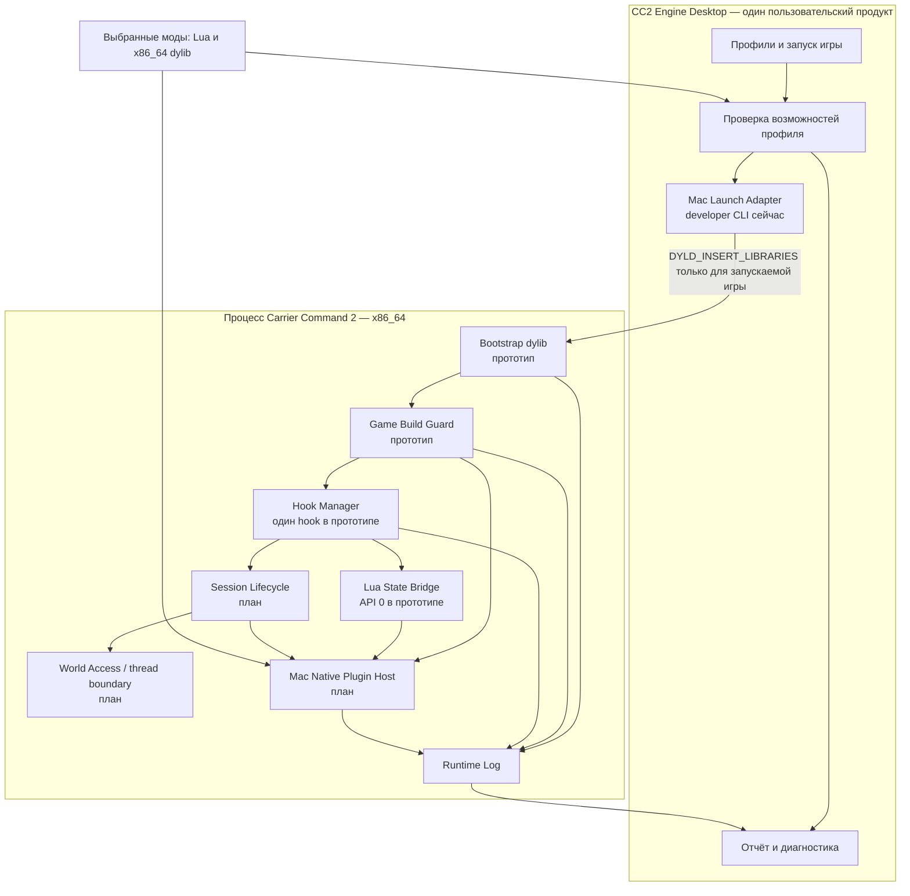

# 15. Mac runtime для CC2 Engine: проверка реализуемости и план

**Дата:** 2026-10-28. **Статус:** инженерный прототип, не готовый пользовательский Mac runtime. Границы существующего продукта остаются в [общем плане](14-UNIFIED-ENGINE-PLAN.md) и [ADR-0005](adr/0005-windows-macos-support.md). Исходник и способ воспроизведения — в [Mac runtime spike](../experiments/mac_runtime/README.md).

## 1. Вывод

В локальной Steam-установке обнаружены **два разных Mac-бинарника**: внешний `v1.5.17` и вложенный `v1.5.18`. Кнопка Steam Play 2026-10-28 запустила внешний `v1.5.17`; вложенный `v1.5.18` запускается напрямую и отмечается Steam как запущенная игра. [Разработчики объявили обновление 1.5.18 с исправлением для macOS](https://steamcommunity.com/app/1489630/allnews/), поэтому считать `1.5.17` единственной или последней Mac-версией было ошибкой. Причина вложенной упаковки и выбора старого внешнего app bundle не установлена.

Для **обоих** точных SHA-256 создан узкий прототип Lua bridge внутри игры. Сторонняя `x86_64` dylib зарегистрировала минимальную таблицу `cc2x` до компиляции скриптов. Каждый бинарник за ограниченный прямой запуск создал 20 Lua-состояний: 20 `PASS`, 0 `FAIL` в самопроверке через Lua. Загрузка реального локального мода, полный игровой сеанс и события мира **ещё не проверены**. Это не готовый Mac CC2X.

Пользовательский продукт остаётся одним: CC2 Engine Desktop на Windows/macOS, который собирает и проверяет профиль. В его поставке могут быть **разные платформенные runtime-компоненты**: существующий CC2X на Windows и разрабатываемый `libcc2x_mac.dylib` для игры на Mac. Пользователь не устанавливает второй менеджер. Для модера цель — общий документированный Lua API и единые проверки, но нативный код придётся собирать отдельно: Windows `32-bit .dll` не загружается в Mac `x86_64` процесс. Даже одинаковый исходный C-код не означает одинаковый бинарный ABI.

## 2. Доказательства и границы

| Наблюдение | Статус | Что именно установлено |
|---|---|---|
| Внешний `carriercommand.app/Contents/MacOS/build_mac`: `x86_64`, 59 482 272 байта, строка `Carrier Command 2 v1.5.17`, SHA-256 `53d8bb02e0fb2b3be764f5d49f8a0e60cf83819ba704e31f3ce75cdef66fd823` | Проверено на этой машине | Хеш совпал с [заметками команды](../../CC2X/00_README.txt). Steam Play запустил именно этот путь; в кэше Steam launch config указан внешний `carriercommand.app`. |
| Вложенный `carriercommand.app/build_mac.app/Contents/MacOS/build_mac`: `x86_64`, 60 040 528 байт, строка `Carrier Command 2 v1.5.18`, SHA-256 `053f026b63ff9611a2eb28fb583031ef091200efc6d8cab1487121575d107b7f` | Проверено на этой машине | Прямой запуск работал 12 секунд; Steam отметил app running. Обычная кнопка Steam Play этот путь не выбрала. |
| Главный исполняемый файл не подписан; Mac — Apple Silicon, Rosetta запускает Intel-код | Проверено на этой машине | Это объясняет техническую возможность текущего эксперимента, но не гарантирует работу после обновления игры или macOS. |
| Конструктор тестовой `x86_64` dylib записал маркер из процесса `v1.5.17` при прямом запуске с `DYLD_INSERT_LIBRARIES` | Динамически проверено | Подтверждена загрузка библиотеки при прямом запуске. Влияние Steam Play на переменную `DYLD_INSERT_LIBRARIES` отдельно не проверено; файлы игры не менялись. |
| Из той же игры через `dlsym(RTLD_DEFAULT, ...)` найдены `lua_gettop` и `lua_pushcclosure` (маркер `lua_gettop=1 lua_pushcclosure=1`); также экспортированы `luaL_newstate`, `luaL_loadbufferx`, `lua_pcallk`, `lua_createtable`, `lua_setglobal` | Динамически и по Mach-O проверено | Можно строить Lua bridge через публичный C API, не повторяя внутреннюю реализацию Lua из Windows CC2X. Наличие символов само по себе не даёт подходящий hook. |
| `mm_lua::reset` создаёт Lua state, регистрирует базовые типы и `MM_LOG`, затем внутри цикла вызывает `luaL_loadbufferx` и `lua_pcallk` для скриптов | Статический разбор Ghidra этой сборки | **Hook на возврате `mm_lua::reset` слишком поздний** для кода, которому `cc2x` нужен при загрузке скрипта. Точка внедрения должна находиться после создания state и до первого выполнения модуля. |
| `c_screen_server`, `c_screen_client`, HUD, overlay, frontend interactions и pause menu вызывают `mm_lua::reset` | Статический разбор Ghidra | Общая функция — перспективная точка покрытия экранов; нужно проверить все состояния в работе игры. |
| На каждом из двух точных SHA прототип заменил в памяти свой guarded `CALL` перед `luaL_loadbufferx`; таблица `cc2x` зарегистрировалась в 20 Lua-состояниях на каждой версии, самопроверки дали 20/20 `PASS` на каждой | Динамически проверено 2026-10-28 | Доказана работа минимального Lua API до компиляции игровых модулей при кратком прямом запуске обоих бинарников. Тип каждого state и работа реального мода не установлены. |
| При инъекции в другой `x86_64` тестовый executable прототип записал `SHA-256 mismatch; hooks disabled`, процесс завершился с кодом 0 | Динамически проверено | Guard не патчил неподдерживаемый процесс. Все варианты отказа в реальной игре ещё не проверены. |
| [Анализ жизненного цикла](../../CC2X/20_session_lifecycle_analysis.txt): серверный поток, создание/удаление мира, загрузка другого save в том же процессе, клиент без локального сервера | Статический анализ команды | Кандидаты событий найдены, но ещё не подтверждены логами hooks в игре. После неудачной загрузки `begin()` всё равно публикует «ready» флаг: по одному флагу нельзя объявлять мир готовым. |

Файлы `CC2X/10`–`16` описывают в основном игровые патчи и методику тестов; `20`–`24` полезны для Native Bridge. Это **текстовые заметки и таблицы символов**, не готовая Mac dylib. Предыдущие `cc2_notes.txt`, `cc2_reference.txt`, `cc2_sources.txt` из первой посылки в текущей папке не найдены; для первого Lua bridge они не требуются, для переноса старых патчей могут понадобиться.

Проверка выполнялась без записи в game bundle, Workshop, `mods.xml` и чужие моды. Прототипная библиотека собирается в `experiments/mac_runtime/build/`, логи лежали во временном каталоге. Повторная проверка SHA-256 **обоих** бинарников после эксперимента дала исходные хеши. Прототип **заменяет приватной копией одну страницу кода только в памяти запущенного процесса**; этот способ ещё не прошёл release review.

## 3. C3: компоненты Mac runtime

**Границы:** Desktop не исполняет Lua или native-код модов. `Launch Adapter` передаёт окружение только запускаемому игровому процессу. `Build Guard` сверяет SHA-256 и исходные байты hook-site до изменений памяти; неизвестная версия — runtime без hooks и с явной диагностикой. `Lua State Bridge` регистрирует API в каждом нужном state до выполнения скриптов, следит за стеком и вызывается только на потоке владельца state. `Session Lifecycle` выдаёт поколения сеансов: после teardown старые игровые указатели недействительны. `World Access` выполняет серверные операции на серверном потоке либо отдаёт Lua копию снимка; прямой доступ из потока меню/клиента к серверным объектам запрещён. `Plugin Host` загружает только Mac `x86_64` dylib активных выбранных модов и сообщает о конфликтующих именах/хуках. Нативные плагины нельзя безопасно выгружать при наличии их Lua closures или callbacks без доказанного контракта завершения; первая версия держит их до выхода игры.

Менеджер слияния файлов остаётся в Desktop: внедрение dylib не устраняет штатные конфликты двух модов с одним игровым путём.

## 4. Матрица совместимости для профиля

| Содержимое мода | Текущий Mac | После Lua bridge | После Mac Plugin Host |
|---|---|---|---|
| Обычные Lua/XML/ресурсы без CC2X | Проверять штатной игрой и упаковщиком | То же | То же |
| Lua вызывает `cc2x.*` | Не объявлять рабочим | Только реализованные и проверенные функции API | То же |
| Windows `.dll` | Блокировать на Mac | Блокировать на Mac | Блокировать; нужен отдельный Mac build |
| Mac `x86_64 .dylib` для bridge | Нет загрузчика модов | Нет загрузчика модов | Проверять API, версию игры и работу в игре |
| Патч по игровому адресу/байтам | Не переносить автоматически | Не переносить автоматически | Только отдельный порт с guard байтов, учётом ASLR и конфликтов патчей |

«Текущий Mac» в таблице означает доступную пользователю поставку, а не developer spike. Экспериментальный `cc2x.api=0` гарантирует только собственные `version`, `game_build`, `has` и `log` в проверенном коротком запуске.

Выводить в GUI не один зелёный «совместим», а доступные возможности: `standard_mod`, `cc2x_lua`, `mac_native_plugin`, `world_read`, `world_write` и конкретные недостающие функции. На Windows и Mac имена Lua-функций стоит держать совместимыми там, где семантика действительно совпадает; внутренний native ABI и адреса игры платформенные. Если функция есть только на Windows, `cc2x.has(...)` и отчёт должны отвечать одинаково честно.

## 5. Этапы, эксперименты и критерии завершения

| Этап | Работа | Готово, когда |
|---|---|---|
| **M0 — доказать вход** | Зафиксировать SHA игры; загрузить пробную dylib; разрешить Lua символы. | **Сделано для прямого запуска двух найденных Mac-сборок**; это не функциональный loader. |
| **M1 — запуск из Engine** | Developer CLI с проверкой SHA/архитектуры уже запускает вложенный `1.5.18` по умолчанию и внешний `1.5.17` явно. Следом упаковать runtime в Desktop/GUI, проверить Steam-сервисы и объяснение выбора сборки. | Игрок нажимает «Играть» в одном GUI, выбранная версия и её путь видны, Steam-сервисы и игра работают, повторный запуск не требует терминала. **Пока не закрыто.** |
| **M2 — минимальный Lua bridge** | Build-specific guarded hooks уже регистрируют `cc2x.version`, `api=0`, `game_build`, `has`, `log`; обе версии прошли 20/20 Lua self-test. Далее проверить реальный локальный мод, все типы state, reset, стек и отсутствие регрессий. | Пробный локальный мод читает `cc2x` при загрузке скрипта в меню и игре; сервер, клиент, HUD, overlay и пауза не теряют штатное поведение; Lua-стек неизменен после callbacks. **Пока не закрыто.** |
| **M3 — сеансы и потоки** | Подтвердить runtime-логами begin/tick/end, teardown и client-only. Ввести generation ID, проверку ошибки загрузки и безопасный переход между потоками. | Тесты: новая игра, save из меню, save поверх текущего, выход в меню, ошибка загрузки, подключение клиентом, завершение процесса; нет вызовов по устаревшим указателям. |
| **M4 — API и нативные плагины** | Сопоставить функции Windows CC2X API с Mac возможностями; сделать минимальный `dlopen` host и платформенный SDK. Перенести один контролируемый плагин из исходников. | Одна и та же пользовательская функция работает в Windows DLL и Mac dylib; unsupported функции и несовместимый ABI блокируются до игры; пути assets и порядок загрузки проверены. |
| **M5 — необязательные игровые патчи** | Переносить конкретные патчи из заметок только по необходимости, с проверкой исходных байтов/хеша, ASLR и пересечений. | Каждый патч проходит отдельный игровой тест и откатывается при ошибке; неподтверждённые адреса никогда не применяются. |
| **M6 — поставка** | Проверить clean Mac, обновление игры, подпись/упаковку Engine, работу Rosetta, диагностику, удаление runtime и документацию авторов. | Весь пользовательский путь GUI-only; Steam/игра не требуют ручного копирования файлов; ошибка версии не вызывает краш и ясно показывает причину. |

**Порядок разработки:** M1 → M2 → M3; только затем M4. Переход к `world_write` и портам игровых патчей до проверки жизненного цикла повысит риск повреждения save и падений. Mac runtime не должен блокировать разработку общего Desktop/merge-ядра на двух ОС.

## 6. Основные ограничения и контрольные случаи

1. **Steam Play и выбор версии:** локально Steam Play запустил внешний `1.5.17`, хотя внутри есть `1.5.18`. Developer launcher по умолчанию напрямую запускает вложенный `1.5.18`; Steam отметил его как запущенный, но overlay, cloud, multiplayer и полный сеанс не проверены. Неизвестно, передаст ли обычная кнопка Steam `DYLD_INSERT_LIBRARIES`; Engine должен явно показывать выбранный executable и не править файлы Steam ради переключения.
2. **Подпись и защита:** текущий `build_mac` не подписан. Если разработчик подпишет игру с Hardened Runtime, `DYLD_*` и загрузка сторонней dylib могут блокироваться без соответствующих entitlements; эти права задаёт владелец исполняемого файла, не наш Desktop. См. документацию Apple по [DYLD entitlement](https://developer.apple.com/documentation/bundleresources/entitlements/com.apple.security.cs.allow-dyld-environment-variables) и [library validation](https://developer.apple.com/documentation/bundleresources/entitlements/com.apple.security.cs.disable-library-validation).
3. **Архитектура:** игра — `x86_64` даже на Apple Silicon; runtime и плагины в её процессе обязаны содержать `x86_64`. `arm64` dylib и Windows DLL не подойдут. Apple [не допускает смешения архитектур в одном процессе](https://developer.apple.com/documentation/apple-silicon/about-the-rosetta-translation-environment) и объявила общий режим Rosetta доступным по macOS 27 включительно; дальнейшая поддержка ограниченного набора старых игр не является гарантией для этого проекта.
4. **Обновление игры:** Mac заметки относятся к `v1.5.17`; вложенный `v1.5.18` потребовал собственный адрес и байты hook-site. Windows CC2X — другая архитектура. Один совпавший символ или сигнатура не подтверждает layout; неизвестный SHA и несовпавшие байты дают отказ.
5. **Ложный world-ready:** после ошибки загрузки сервер может выставить флаг готовности до `abort_load_game`; проверка должна учитывать код ошибки и generation ID. При join к удалённой игре локального `c_logic_server` нет.
6. **Повторная загрузка:** переход к другому save уничтожает старый мир и создаёт новый в том же процессе; нельзя кэшировать сырые указатели или считать событие начала процесса началом каждого игрового сеанса.
7. **Lua state:** их несколько, они создаются повторно. `cc2x` необходимо вводить до запуска модуля в каждом нужном state; вызовы из чужого потока и неправильная работа со стеком могут повредить игру.
8. **Native-моды:** исходный Windows-плагин может зависеть от WinAPI, 32-битных структур, порядка callbacks, конкретных адресов и ресурсов рядом с DLL. Нужны исходники и порт; автоматическая перекомпиляция или «конвертация DLL» невозможна.
9. **Совместное слияние:** даже работающий runtime не позволяет игре активировать два мода с совпадающими игровыми файлами. Для них нужен отдельный merged mod, с проверкой `plugin_dir` и assets перед отключением исходников.
10. **Прототипный patch mechanism:** исходный `__TEXT` запрещает запись; spike заменяет одну страницу приватной копией через `MAP_FIXED`, затем возвращает RX. Это сделано до старта игровых потоков и проверено только на текущем окружении. Перед поставкой нужна проверка на других Mac, crash recovery и безопасный механизм установки hooks; один успешный запуск этого не доказывает.

## 7. Решение для следующей итерации

Следующий проверяемый результат — **локальный тестовый мод в полноценном игровом сеансе**, читающий минимальный `cc2x` API на этапе загрузки; параллельно проверить Steam-сервисы при прямом запуске. Затем подключить runtime к GUI Engine без ручных команд. До этих проверок не обещать совместимость Windows native-модов, world API и готовые игровые патчи.
