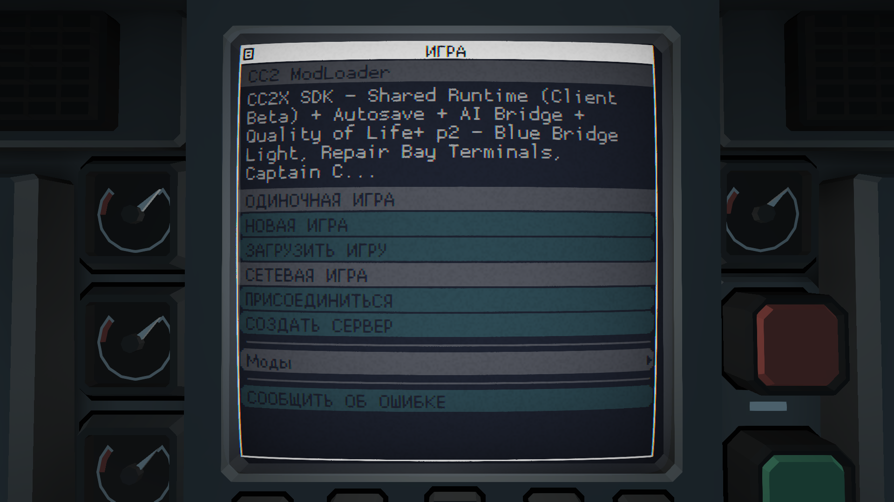
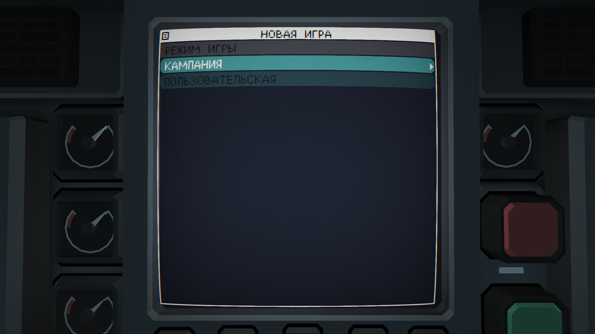

# Beta 7 Windows main-menu verification

Status: final packaged-pair Windows managed-menu and SDK-only control checks
passed, 2026-11-04.

This record covers CC2 ModLoader's main-menu extension on the reviewed Windows
Carrier Command 2 1.5.18-r2 profile. It does not establish full gameplay,
multiplayer, dedicated-server, clean-machine or macOS runtime acceptance.

## Exact candidate

| Component | Identity |
| --- | --- |
| ModLoader | 0.4.0b7, Windows x64 GUI |
| `CC2ModLoader.exe` SHA-256 | `17b33801f9bd1a7f4b3b2a25183f2a3549cd38e1d10dce6ba4d25fea36c1764d` |
| SDK | 0.7.1-client-beta.1 maintenance release |
| `dinput8.dll` SHA-256 | `c741ed111cdb186463c01f6e9e189fb80ee15b43bc52e6bacdd92fe88ee95d12` |
| SDK source commit | `59a8f9a48e51e8559d7c32deac2677c8f2059bee` |
| Generated policy | `sdk-screen-extension-v4` |
| Game EXE SHA-256 | `461e12623bacb7de29ca27b4614425c87e8df2c8327a5e958a957c850effe42a` |
| Generated package manifest SHA-256 | `4cf0b09f77f47350625bb0201bf6308eda1641a8d618f3ef2cf2cfbc6d674a2f` |
| Extension source SHA-256 | `fc1ad07beed6417835f357f9ed475b6b0fde4b7020a40c026fa0999403f3e4df` |
| Declaration SHA-256 | `bf8866e171de49eb37ec766aa87ce3ec8a2c6f0207391ca39207c6e75f9d47b5` |
| Tested game log SHA-256 | `640b47c4f7343f5ebe3db0fab33743a84f08577a797c4889245e7ce21e3f099e` |

The SDK dependency is pinned to this maintenance release. The parallel SDK 0.8
release and its latest-release channel are separate.

## Checks and evidence

The exact final EXE/runtime pair above was launched through ModLoader with nine
selected packages. The real menu displayed the ModLoader heading and compact
selected-mod names. Mods was gray; both a mouse click and Enter left the Mods
screen closed. New Game opened normally. These results cover actual menu
interaction, not only the owned callback fixture.

The tested SDK log recorded one active package and one extension, with zero
diagnostics, followed by:

```text
event=SCREEN_EXTENSION_SOURCE_QUEUED screen=scripts/screen_menu_main.lua source=cc2x/ui/modloader_menu.lua bytes=5074
```

The original full log remains local because it can contain private paths. Its
SHA-256 is recorded above. The public screenshots below are lossless BMP-to-PNG
format conversions of the accepted captures, with no crop or retouching. They
contain only the game view. The game language in this test was Russian; the
application retains all 14 offline language catalogs.





| Public capture | SHA-256 |
| --- | --- |
| `05-game-managed-menu.png` | `2323a854f9f78042da2dfd45979598e4eaf88e6c670b3632ce900403066dfd97` |
| `06-game-new-game.png` | `8de05175e1e7d9c92970b187072b0d6af6105e12ff1116baf328a9c5a6b79611` |

Original accepted BMP capture hashes are
`7999cff53cce52d785f0e0d3fc62111bf20619ad69637c9bb1c7159c781de63f`
(Mods after Enter) and
`ab03122fc2a87a11abee69f36697252da6d20f483769813cd9e8267f7552ad9d`
(New Game). The local receipt also retains the mouse-click capture hash,
`5b152efa87f8e23257bdb8348ed2a9cb2288fbb9c88d686fc33a0328915de066`.

## SDK-only control

The same final SDK runtime was also launched with no enabled extension
packages. The ordinary Mods entry opened the game's mod list, the ModLoader
heading was absent, and the SDK log reported:

```text
event=SCREEN_EXTENSIONS_READY active_packages=0 extensions=0 diagnostics=0
```

This confirms that the framework alone does not impose ModLoader's menu policy.
The original managed nine-package selection was restored after the control
test. The local control receipt records:

| Control evidence | SHA-256 |
| --- | --- |
| Tested SDK-only log | `f6541a314fd5c9cbf995262d2015bbfd4058832ad89718cf5f1875f063b86d4a` |
| Original Mods-open BMP capture | `f768e2b5fa3af6159cababa0224f09cac9f86f25be61ad2021821570669f1427` |

The log and original capture remain local; private installation paths are not
included in this record. Removal/Undo also retains its offline regression
coverage. These menu checks do not establish gameplay or network acceptance.

Owned Lua fixtures cover behavior; SDK/package fixtures cover delivery,
integrity and path validation. They complement the live menu check and do not
certify gameplay compatibility between selected mods.

## Historical defect

Beta 5/6 placed a decorator in a generated ordinary menu resource. The game's
initial menu clears those resource overlays, leaving Mods clickable. Beta 7
uses the generic SDK screen-extension boundary after stock screen loading and
before `begin()`. The SDK supplies that capability; the generated ModLoader
package owns the menu policy. See [ADR-0030](../adr/0030-sdk-screen-extension-delivery.md).
